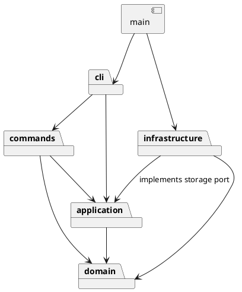

# Lab1 Phase 1 设计与开发记录

本工程依据 `phase_cli_1.md` 实现。以下记录区分既定方案、实际实现与验证结果；未完成项不会写成已通过。

## 架构方案

### 模块划分

| 模块 | 职责 |
| --- | --- |
| `src/domain/` | 图形类、组合容器、文档树、几何与属性校验；不依赖 CLI、XML 库或文件系统 |
| `src/application/` | 当前文档、历史记录、文档存储接口与命令执行边界 |
| `src/commands/` | 每条用户命令一个类，编辑命令拥有 execute/undo/redo 行为 |
| `src/cli/` | 分词、命令注册、输入输出循环与用户错误反馈 |
| `src/infrastructure/` | XML 编解码及本地文件读写，实现应用层存储接口 |
| `src/main.ts` | 唯一组装入口，连接具体存储与 CLI |
| `test/` | 模型、命令、SVG 往返与真实进程集成测试 |
| `examples/` | 可重放命令脚本及 SVG 示例 |

### 设计模式的选择

- **Command（必选）**：每个编辑命令封装一次修改；通过可撤销命令基类保存修改前后文档快照。历史管理器只认识命令接口，不按命令名称分派撤销逻辑。
- **Composite**：`Shape` 是共同抽象，矩形、圆、椭圆、线、文字为叶子，`Group` 是容器；移动、缩放、复制等操作通过多态递归执行。
- **Memento**：编辑命令使用文档深复制保存快照，确保复杂分组的撤销恢复完整层级与顺序。代价是每次编辑 O(n) 空间；本阶段图形数量小，优先正确性与可解释性。
- **Factory**：图形工厂集中注册六种类型，CLI 创建与 SVG 导入共享同一类型分派入口。
- **依赖倒置**：应用层声明存储接口，本地文件实现位于基础设施层，测试可用内存实现。

按名字分派严格限制在 `CommandRegistry`（命令名到命令构造器）和 `ShapeFactory`（图形名到构造器）。**这两处固定注册表标记为后续插件化阶段待重构项**，当前不提前实现插件发现、加载或 `box` 类型。

### 依赖方向规则

1. `domain` 只依赖同模块；业务对象自身负责行为及校验，禁止空数据袋配合外部类型判断。
2. `application` 只依赖 `domain`；文件读写经接口注入。
3. `commands` 依赖 `application` 与 `domain`，不直接调用文件系统。
4. `cli` 依赖 `commands` 与 `application`；界面格式由对象提供，不按图形名称分支。
5. `infrastructure` 依赖 `application` 的接口与 `domain`，禁止反向依赖界面和具体命令。
6. `main` 是组装入口，允许引用各层具体实现。

### 变化点假设

| 变化点 | 当前安排与取舍 |
| --- | --- |
| 新增图形 / 后续 box | Shape 多态与集中工厂；暂不实现插件系统 |
| 增加命令 / 换成 GUI | 命令独立于 readline，保留统一执行入口 |
| 存储改为远程 | 通过存储接口替换；本阶段仅本地文件 |
| 大规模撤销历史 | 当前深复制快照易验证，后续可换为增量命令或限额历史 |
| 任意 SVG / CSS / 路径 | 本阶段聚焦六种类型；扩展兼容范围须明确记录，不能静默丢失未知元素 |

## 过程记录

### 2026-10-23：需求核对与初始方案

- 用户授权按作业要求开发，并询问 GitHub 账号信息是否必要。
- 检查确认：目录仅有需求文档，已有 Git 和 Node.js，无现成项目或仓库。使用独立 `svg-editor` 子目录，避免混入其他课程文件。
- AI 核对阶段边界：`box` 是后续阶段功能，本阶段应返回 unknown shape type。
- 先记录架构并提交，再逐步实现模型、命令、IO 与测试；不在完成后伪造开发历史。
- GitHub 仓库、截止时间及补充要求等待用户提供。本地开发可以独立继续。

## 一致性自查

待实现完成后检查实际目录、依赖和方案修订。

## 质量保证手段

计划使用 TypeScript 严格类型检查与 Node 内置测试运行器。重点覆盖六种图形、嵌套容器、复合编辑撤销、错误原子性、IO 历史屏障、XML 往返、自动补 ID、脚本重放及真实 CLI。最终在此填写实际结果。
