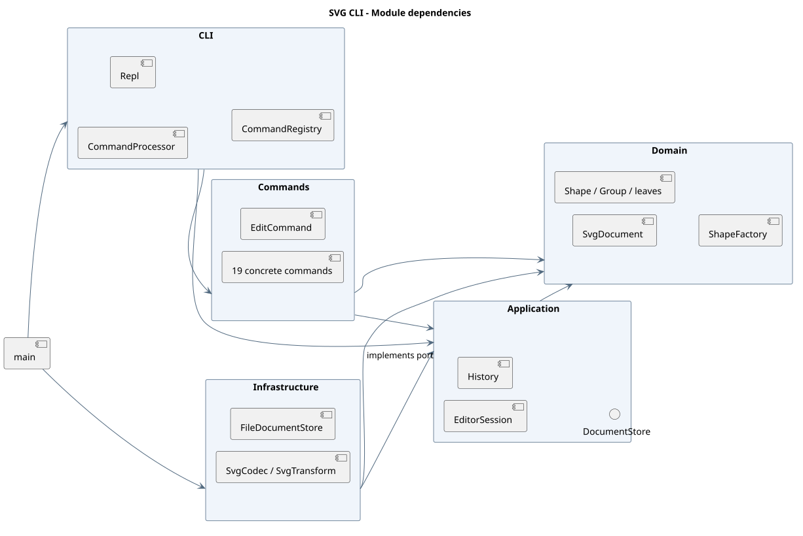
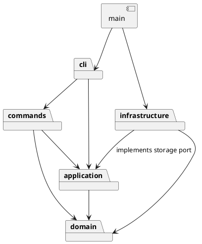
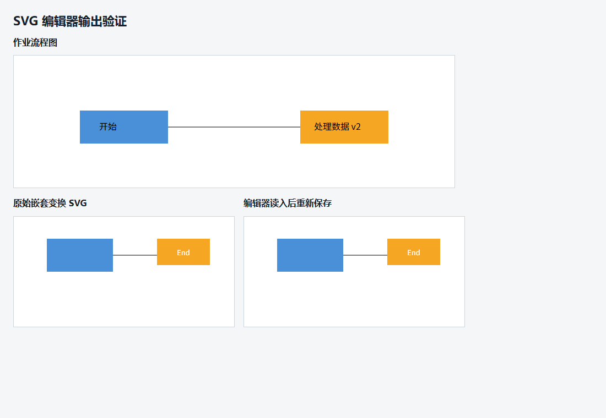

# Lab1 Phase 1 设计与开发记录

本工程依据 [课程原文](requirements.md) 实现。以下记录区分既定方案、实际实现与验证结果。协作中用户提供作业目标、账号、私有仓库要求和截止日期；Codex 完成实现、测试及自查。记录中的技术审查为实际 AI 自查，不虚构学生发现问题或课堂讨论。

## 架构方案

### 模块划分

| 模块 | 职责 |
| --- | --- |
| `src/domain/` | 图形类、组合容器、文档树、几何与属性校验；不依赖 CLI、XML 库或文件系统 |
| `src/application/` | 当前文档、历史记录、文档存储接口与命令执行边界 |
| `src/commands/` | 每条用户命令一个类，编辑命令拥有 execute/undo/redo 行为 |
| `src/cli/` | 分词、命令注册、输入输出循环与用户错误反馈 |
| `src/infrastructure/` | XML 编解码及本地文件读写，实现应用层存储接口 |
| `src/main.ts` | 唯一组装入口，连接具体存储与 CLI |
| `test/` | 模型、命令、SVG 往返与真实进程集成测试 |
| `examples/` | 可重放命令脚本及 SVG 示例 |

完整可重绘源文件：[architecture.puml](architecture.puml)。下方为依赖关系的简化 PlantUML 表达。

### 设计模式的选择

- **Command（必选）**：每个编辑命令封装一次修改；通过可撤销命令基类保存修改前后文档快照。历史管理器只认识命令接口，不按命令名称分派撤销逻辑。
- **Composite**：`Shape` 是共同抽象，矩形、圆、椭圆、线、文字为叶子，`Group` 是容器；移动、缩放、复制等操作通过多态递归执行。
- **Memento**：编辑命令使用文档深复制保存快照，确保复杂分组的撤销恢复完整层级与顺序。代价是每次编辑 O(n) 空间；本阶段图形数量小，优先正确性与可解释性。
- **Factory**：图形工厂集中注册六种类型，CLI 创建与 SVG 导入共享同一类型分派入口。
- **依赖倒置**：应用层声明存储接口，本地文件实现位于基础设施层，测试可用内存实现。

落地位置：`commands/EditCommand.ts` 实现 Command 与快照恢复，`application/History.ts` 管理执行/撤销/重做，`domain/Shape.ts` 与 `domain/Group.ts` 实现组合多态，`domain/ShapeFactory.ts` 统一创建图形，`application/DocumentStore.ts` 是存储边界。

编辑流程为：输入 → Tokenizer → CommandRegistry → 具体命令 → History → 在克隆文档上执行 change → 成功后替换当前文档并记录快照。异常沿调用链返回 CommandProcessor，由它统一输出单行 `error:`。`main.ts` 只组装依赖；生产代码的业务行为均封装在类中。

按名字分派严格限制在 `CommandRegistry`（命令名到命令构造器）和 `ShapeFactory`（图形名到构造器）。**这两处固定注册表标记为后续插件化阶段待重构项**，当前不提前实现插件发现、加载或 `box` 类型。

### 依赖方向规则

1. `domain` 只依赖同模块；业务对象自身负责行为及校验，禁止空数据袋配合外部类型判断。
2. `application` 只依赖 `domain`；文件读写经接口注入。
3. `commands` 依赖 `application` 与 `domain`，不直接调用文件系统。
4. `cli` 依赖 `commands` 与 `application`；界面格式由对象提供，不按图形名称分支。
5. `infrastructure` 依赖 `application` 的接口与 `domain`，禁止反向依赖界面和具体命令。
6. `main` 是组装入口，允许引用各层具体实现。

同层内部依赖允许。Node 内置输入输出仅在 cli/infrastructure/main 中使用，第三方 XML 库仅出现在 infrastructure。测试可引用各层，并用独立临时目录测试文件读写。

### 变化点假设

| 变化点 | 当前安排与取舍 |
| --- | --- |
| 新增图形 / 后续 box | Shape 多态与集中工厂；暂不实现插件系统 |
| 增加命令 / 换成 GUI | 命令独立于 readline，保留统一执行入口 |
| 存储改为远程 | 通过存储接口替换；本阶段仅本地文件 |
| 大规模撤销历史 | 当前深复制快照易验证，后续可换为增量命令或限额历史 |
| 任意 SVG / CSS / 路径 | 本阶段聚焦六种类型；扩展兼容范围须明确记录，不能静默丢失未知元素 |

## 过程记录

### 2026-10-23：需求核对与初始方案

- 用户授权按作业要求开发，并询问 GitHub 账号信息是否必要。
- 检查确认：目录仅有需求文档，已有 Git 和 Node.js，无现成项目或仓库。使用独立 `svg-editor` 子目录，避免混入其他课程文件。
- AI 核对阶段边界：`box` 是后续阶段功能，本阶段应返回 unknown shape type。
- 先记录架构并提交，再逐步实现模型、命令、IO 与测试；不在完成后伪造开发历史。
- GitHub 仓库、截止时间及补充要求等待用户提供。本地开发可以独立继续。

### 2026-10-23：模型阶段

- 用户确认账号为 `zhangshao04`，要求私有仓库，截止日期为 10 月 30 日，无补充要求。已创建私有仓库 `zhangshao04/lab1-svg-cli`，并推送初始设计。
- 实现六种图形与组合树，几何校验封装在对象内部，图形工厂是唯一图形类型分派位置。
- 需求未明确跨父级 group 的新容器位置：同父级时放在原先第一个选中节点的位置；跨父级时放在画布末尾；子节点统一保留文档遍历顺序。此为实现决策，不宣称为老师额外要求。
- 首次严格编译发现当前 TypeScript 需要显式声明 Node 类型，补充 `types: ["node"]` 后重新验证。

### 2026-10-23：命令与撤销阶段

- 每条编辑命令先在克隆文档上工作，成功后才替换当前文档和压入历史；测试验证递归缩放中途数值溢出也不会泄漏部分修改。
- 成功的文档 IO 清空历史并设置屏障，失败 IO 不改动文档、路径和历史；新编辑仅在成功后清空 redo。
- 分词器只把整行开头的 `#` 当注释，避免误删十六进制颜色；保留带空格路径、空字符串和中文文字。
- 当前 11 项模型与命令测试通过，涵盖所有编辑命令的撤销和重做。

### 2026-10-23：SVG 与 CLI 集成阶段

- 接入独立 XML 编解码器和本地文件存储；读取先解析完整临时文档再替换，保存先写同目录临时文件再改名，失败不建立历史屏障。
- 预先收集全部显式 ID 后再自动命名，避免前面的无名元素抢占后面已有的 `rect1`。
- 需求背景含嵌套 `translate` / 等比 `scale`。导入时将这类变换折算为几何属性，同时按导入变换调整文字字号和描边宽度；CLI `scale` 仍严格只缩放几何属性。
- 引入 `--script` 回放入口；批处理出现错误时仍继续执行后续行，但最终退出码为 1，便于自动验收。
- 完成 21 项测试，包括真实子进程回放作业流程图、重复覆盖保存及异常文件读写。

### 2026-10-23：最终审查与修正

- AI 审查发现初版 `Numbers.format` 固定 14 位有效数字会改变可精确表示的大数。改为保留 JavaScript number 的可往返字符串表示，并增加大整数和高精度小数回归测试。
- 发现 SVG 根元素已有 ID 在后续 create/group 中未被保留；将根 ID 纳入唯一性检查，补充测试。
- 发现文本中的非法控制字符会使保存结果不符合 SVG/XML 字符范围；新增 TextValue 校验，验证失败修改不破坏原文字，中文与 emoji 继续可用。
- 统一 ungroup 缺失图形的错误语义，补充作业指定错误文本的逐项检查。
- 增加跨父级分组、删除和连续撤销测试，以及自动模块依赖检查。当时 27 项测试通过。
- 使用独立无界面 Edge 打开实际输出，核对中文流程图与嵌套变换导入后的外观；结果见下方截图。架构图通过本地 PlantUML 生成，没有上传项目源码到在线渲染服务。

### 2026-10-29：复查修正与重新提交

- 用户要求复查仓库，随后授权修正并重新提交。确认本地与远程均为原交付提交 `2b500c9`，在其后增加修正提交，保留已有开发历史。
- 复查发现：`read original.svg` 后执行 `save copy.svg`，原实现会把无参数 save 的目标改成副本，与原文“保存到读入时的路径”不符。将读入路径与最近成功保存路径分别记录；读入路径优先，显式另存不覆盖它，成功 init 清空二者。只有没有读入路径的新建文档才使用最近成功保存路径作为默认值。
- 复查发现：读入文字中的 `&#13;` 后，原序列化器输出字面回车，再读入时会被 XML 换行规范化改变。保存时将回车写为 `&#13;`，保留 CR、LF、CRLF、制表符、中文和字面量 `&#13;` 的区别。
- 新增 5 项回归测试，覆盖默认保存路径、更换读入文件、新建文档的路径生命周期、失败读写与撤销重做、连续两轮文字往返及真实文件保存。修复前 4 项失败、1 项通过，验证能够复现问题；修复后完整严格编译和 32 项测试全部通过。
- 同步更正说明文档中对 save 默认路径的解释，更新测试原始输出。此次重新提交使用新提交，并按用户要求让 `final` 标签对应修正后的交付版本。

### 2026-10-29：第二轮边界修正

- 用户要求修复再次审查发现的四处问题，补充测试、重新提交并更新 `final`。本轮在已交付的 `d6ddafe` 后继续追加提交。
- 根元素 `id`、`version`、`preserveAspectRatio` 中的非法字符引用曾绕过校验，使无效文件替换当前文档并建立历史屏障。现在解析前验证源文本，提取属性时验证解码后的字符；真实文件测试确认读取失败保留文档、原保存路径与 undo/redo。
- 导入缩放变换时曾只缩放坐标、描边宽度与字号，遗漏虚线长度。现在沿根元素及嵌套组传递虚线样式，对叶子的有效虚线长度进行换算，并处理显式覆盖、`none`、`inherit`、`unset`、`initial`。缩放支持数值和 px；不能可靠换算的单位明确报错，避免静默改变外观。
- 带引号的 Windows 网络路径曾把开头两个反斜杠合并为一个。分词器现在对 UNC / 设备路径保留原始反斜杠，其他文字沿用转义规则，完全转义的旧路径写法仍可用。测试通过内存存储验证 read/save 和默认保存收到的完整路径，不连接实际共享服务器。
- 原实现对整个 XML 文本搜索 `<!DOCTYPE` / `<!ENTITY`，会误拒绝注释和 CDATA。改为检查解析后的文档类型节点；真正的 DTD、实体声明和非良构 XML 仍拒绝，普通文本按原内容往返保存。
- 新增 10 项回归测试，修复前 8 项失败、2 项通过；修复后严格编译与完整 42 项测试全部通过。同步更新使用说明、支持边界和测试原始输出。

### 2026-10-30：Unicode 换行修正

- 提交前复查发现，XML 库默认的扩展换行规则会把 U+0085（NEL）、U+2028（行分隔符）、U+2029（段落分隔符）改成普通 LF，导致文字与属性值往返不一致。用户要求修复、补测并重新提交。
- 为解析器显式配置 XML 1.0 换行处理，只将字面的 CR / CRLF 规范化为 LF，保留上述 Unicode 字符。保存时仍将文字中的 CR 写为字符引用，原有回车保护继续生效。
- 新增 4 项回归测试：普通文字 / CDATA / 字符引用的多轮往返；CR、CRLF、LF 与 Unicode 分隔符的混合输入；根元素与图形属性；真实 CLI 子进程读取外部 SVG、另存、再次读取、修改与撤销后保存。修复前 4 项均失败，修复后严格编译和完整 46 项测试全部通过。
- 本次未修改依赖或其他命令语义。同步更新文档及测试原始输出，以新提交继续保留开发历史，按用户要求更新 `final`。

### 需求未明确处的实现决策

| 问题 | 决策 |
| --- | --- |
| help 是否需要当前文档 | 允许启动后直接 help，其他需要文档的命令保持错误约定 |
| IO 后旧历史是否还能恢复 | 成功 IO 清空历史并设屏障；下一次成功编辑开始新的历史，避免跨文档撤销 |
| init 后未读入文件的默认保存路径 | 没有读入路径时记住最近一次成功 save 路径；首次保存须显式指定；失败不修改路径 |
| group 顺序与新容器位置 | 文档顺序优先；同父级占首个选中位置，跨父级放画布末尾 |
| g 的 set fill | 设置容器属性，采用 SVG 原生继承，不覆盖子节点显式属性 |
| canvas 只给一个尺寸 | 报参数错误；修改画布必须同时给宽和高。init 可只给宽，高默认为 600 |
| 不支持的外部 SVG 内容 | 明确拒绝，保持原文档；不承诺完整 SVG 浏览器规范 |
| 导入变换的编辑坐标 | translate/正向等比 scale 折算到图形几何属性，再进行普通编辑 |
| 数值精度 | 使用 JavaScript 双精度数；序列化不额外截断，超出有限数范围报错 |

这些决策均作为工程解释记录，未冒充教师补充要求。对于已经 read 的文档，无参数 save 返回读入路径是课程原文的明确要求，不属于上述可选决策。

## 一致性自查

### 模块划分

实际目录与初始方案一致。增加的 Numbers、TextValue 属于 domain 内的校验职责，SvgTransform 属于 infrastructure 的导入兼容职责，未新增跨层模块。接口和类型定义可以单独成文件；每个生产类与其文件同名且一文件一类。

修订记录已在模型阶段、命令阶段、SVG 阶段、最终审查、10 月 29 日复查和 10 月 30 日 Unicode 修正中列出。`doc/requirements.md` 保存原始说明，`examples/` 保存可执行案例，`.tmp/`、编译产物与依赖目录不纳入 Git。

### 依赖方向

`test/architecture.test.ts` 扫描所有生产源码的导入关系，并校验上面的模块依赖规则；当前检查通过。抽样核对：

- `domain/Group.ts` 只引用 Shape 和 Numbers，通过调用子对象的 move/scale 实现递归，无图形类型分支。
- `application/EditorSession.ts` 只引用领域文档和应用层接口/历史管理器，没有 fs 或 XML 依赖。
- `commands/CreateCommand.ts` 只依赖应用层、领域工厂和同层参数/命令基类。
- `infrastructure/FileDocumentStore.ts` 实现 DocumentStore，负责 fs 操作，应用层无需反向引用它。
- `cli/CommandRegistry.ts` 统一分派命令；`domain/ShapeFactory.ts` 统一分派图形类型。除此以外不按图形或命令名称分派业务行为。XML 节点种类与变换语法的校验不承担图形类型分派。

静态检查同时禁止 `switch`，但测试不能代替架构判断；以上抽样核对用于确认分层意图。当前没有已知违反依赖方向的项。两个固定注册表仍为后续插件化待重构项。

## 质量保证手段

### 自动检查

执行 `npm test`：先使用 TypeScript 严格模式编译，再使用 Node 内置测试运行器。2026 年 10 月 30 日 Unicode 修正后的本地结果为 **46 项通过、0 项失败、0 项跳过**。

2026 年 10 月 30 日修正前，从当时的 `final`（`52c6609`）导出独立干净副本，重新执行 `npm ci`、42 项测试、需求原文典型会话与流程图案例，全部通过，未使用原工作目录的 node_modules 或 dist。本次未修改依赖，修正后在工作目录重新执行完整 46 项测试；最新原始输出保存在 [test-results.txt](test-results.txt)。

| 测试文件 | 核心证据 |
| --- | --- |
| `test/domain.test.ts` | 六种图形的移动/缩放/克隆、样式省略、嵌套组、绘制顺序、非法结构与属性 |
| `test/commands.test.ts` | 全部编辑命令的单步撤销和重做、跨父级恢复、准确错误文本、失败回滚、redo 清空、IO 屏障、分词和 Unicode；默认保存路径；网络路径原样传递与文字转义兼容 |
| `test/svg.test.ts` | 七元素导入示例、自动 ID 预留、XML 转义、空文字、viewBox、嵌套变换、数值精度、拒绝未知内容、覆盖保存和失败 IO；CR/LF/CRLF 与 Unicode 分隔符在文字、CDATA、字符引用和属性中的往返 |
| `test/svg-import.test.ts` | 根属性非法字符拒绝、真实文件导入失败后文档/路径/历史保持、CDATA 与实际声明区分、继承/覆盖虚线的缩放与往返、特殊值、非法单位及溢出 |
| `test/cli.test.ts` | 独立进程验证 Windows 换行、错误后继续执行、脚本回放生成八元素流程图、退出码与启动失败；外部 SVG 的 Unicode 文字读写及撤销后原样保存 |
| `test/architecture.test.ts` | 所有源文件的模块依赖、一类一文件、文件名匹配与禁止 switch |

严格编译开启 strict、noUncheckedIndexedAccess、exactOptionalPropertyTypes、noImplicitOverride、noUnusedLocals 等检查。测试在系统临时目录进行真实文件读写并清理自身创建的目录，不依赖用户文件或网络。

### 功能覆盖对应

| 需求 | 对应实现 / 验证 |
| --- | --- |
| 19 条命令与六种内置图形 | CommandRegistry / ShapeFactory；命令、模型与 CLI 测试 |
| 一条编辑一次撤销；复杂结构完整恢复 | EditCommand 快照 + History；逐命令往返与跨父级测试 |
| 编辑失败不改变状态 | 候选文档提交机制；递归溢出与非法操作测试 |
| 文件读写后历史屏障 | EditorSession；成功 IO/失败 IO 与显示类命令对照测试 |
| 无参数 save 写回读入路径 | EditorSession 分别记录读入路径和保存路径；另存副本、切换读入文件与失败 IO 回归测试 |
| 带空格的 Windows 网络路径 | Tokenizer 保留 UNC / 设备路径反斜杠；分词、原文字转义与内存存储参数传递测试 |
| 唯一 ID 与缺失补齐 | SvgDocument / SvgCodec；后出现显式 ID、根 ID、重复 ID 测试 |
| SVG 可视化与往返 | DOM 编解码；浏览器截图、原样式和变换后视觉对照；文字回车、Unicode 分隔符、CDATA、根属性校验与虚线变换回归测试 |
| 架构和设计模式 | 模块图、类职责说明、自动依赖检查和抽样审查 |
| 开发过程 | 初始设计、模型、命令、IO、修正和文档分别提交并推送 |

### 浏览器验证

上方为作业流程图脚本输出，下方左右分别为原始嵌套变换示例与编辑器读入后重新保存的结果。已目视核对图形位置、尺寸、连线、颜色和文字。

### 已知边界

- 本阶段不实现 `box` 创建和插件加载；导入已有 `g data-kind="box"` 时作为普通 g 处理。
- 本编辑器支持作业规定的 SVG 子集；不支持路径、CSS、滤镜、渐变、use、tspan 和任意仿射变换。不支持内容返回错误，保留当前文档。
- 需要缩放的虚线长度支持无单位数值和 px；百分比、em 等其他单位明确拒绝，纯平移或无缩放时原样保留。真正的 DTD / 实体声明不支持；注释和 CDATA 中的相同文字允许。
- 撤销为全量快照，时间和空间随文档规模增长；历史没有容量限制，适用于本阶段的小型文档。
- 移动节点不会自动修改独立连线；普通组样式遵循 SVG 继承规则。
- 已在 Windows / Node.js 24.14.1 完成本地验证；没有宣称已在其他系统运行测试。

### 提交复核

仓库保持私有。`main` 保存真实分步历史，最终交付使用 `final` 标签。使用 `git log --oneline` 查看阶段记录，使用 `git show final` 查看交付提交；远程标签通过 `git ls-remote --tags origin final` 验证。截止日期为用户确认的 2026 年 10 月 30 日。

2026 年 10 月 29 日完成两轮修正，10 月 30 日补充 Unicode 换行修正并按用户要求重新提交。此前的 `2b500c9`、`d6ddafe`、`52c6609` 均保留在历史中，`final` 用于本次 Unicode 修正后的版本。
